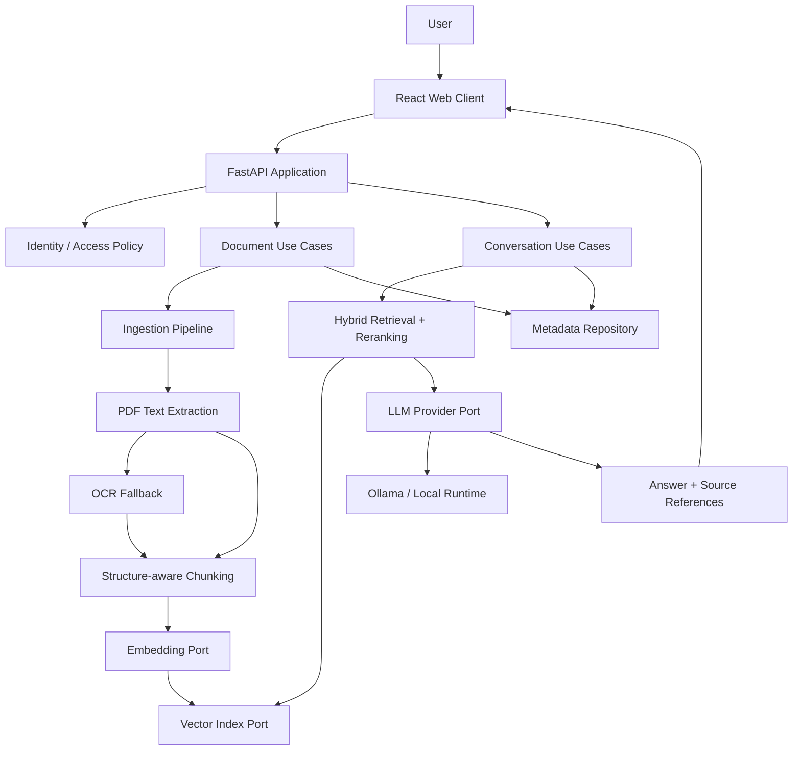

# ChatWithPDF Architecture

**Owner:** Yuktara Technologies  
**Status:** Target architecture; implementation is incremental  
**Architecture style:** Modular monolith with explicit ports and adapters

## 1. Product principles

1. Local-first inference: documents and prompts remain on the user's machine unless a deployment explicitly configures a remote provider.
2. Grounded answers: answers must be supported by retrieved document passages and expose page-level citations.
3. Explicit boundaries: HTTP, business workflows, domain rules, and third-party libraries must not be mixed.
4. Replaceable infrastructure: model runtimes, vector stores, PDF parsers, and persistence adapters are accessed through interfaces.
5. Secure defaults: validate uploads, isolate document ownership, minimize retained data, and never trust document text as instructions.
6. Observable behavior: structured logs, health/readiness checks, timings, and actionable errors.
7. Testability: business logic must be testable without starting Ollama, a browser, or a real database.

## 2. System context



## 3. Backend boundaries

The target backend layout is:

```text
backend/
  app/
    main.py                 # composition root and ASGI application
    api/
      v1/
        router.py
        endpoints/
        dependencies.py
    application/
      documents/
        ingest_document.py
        list_documents.py
        delete_document.py
      conversations/
        ask_question.py
        clear_conversation.py
      ports/
        document_repository.py
        vector_index.py
        embedding_provider.py
        llm_provider.py
        file_storage.py
    domain/
      documents/
        entities.py
        value_objects.py
        exceptions.py
      conversations/
        entities.py
        citations.py
    infrastructure/
      pdf/
        pdfplumber_extractor.py
        ocr_extractor.py
      embeddings/
        sentence_transformer_provider.py
      vector/
        faiss_index.py
      llm/
        ollama_provider.py
      persistence/
      storage/
    core/
      config.py
      logging.py
      security.py
      errors.py
  tests/
    unit/
    integration/
    contract/
```

The existing `backend/main.py`, `core/`, and `services/` code must be migrated behind these boundaries in small steps. Do not delete or rename working modules until imports, API contracts, and tests have been migrated.

### Dependency direction

- API endpoints call application use cases.
- Application use cases depend on domain objects and declared ports.
- Domain code has no FastAPI, LangChain, FAISS, Ollama, or filesystem imports.
- Infrastructure implements ports; it must not become the owner of business rules.
- The composition root wires implementations together.

## 4. Frontend boundaries

The target frontend layout is:

```text
frontend/src/
  app/
    App.jsx
    providers/
    router/
  features/
    documents/
      api/
      components/
      hooks/
      pages/
      types/
    chat/
      api/
      components/
      hooks/
      pages/
      types/
    analytics/
    settings/
  shared/
    api/
    components/
    hooks/
    lib/
    styles/
    types/
```

Feature modules own their UI, API adapters, hooks, and feature-specific types. Shared components must be domain-neutral. Components should not call raw endpoints directly; use feature API modules.

## 5. Document ingestion lifecycle

1. Validate extension, MIME signature, size, page count, and encrypted/corrupt state.
2. Generate an opaque document ID and store the file outside the public web root.
3. Extract non-empty page text while preserving original one-based PDF page numbers, including gaps for blank pages.
4. Run OCR only for pages with insufficient extractable text.
5. Normalize text without removing meaningful headings, tables, or page boundaries.
6. Chunk each extracted page independently with bounded size and overlap so a chunk never loses its source page.
7. Generate embeddings in batches using the configured embedding model.
8. Assign a server-generated document ID and persist each chunk with document ID, filename, original page number, and chunk indexes in the workspace index. The current local adapter writes vectors and chunk metadata together in one atomically replaced NumPy archive.
9. Expose workspace document inventory only after indexing is complete; support deletion of a document and its associated vectors.
10. On failure, clean temporary files and mark the document failed with a safe error code.

## 6. Retrieval and answer lifecycle

1. Validate the question and authorize access to the selected document scope.
2. Retrieve candidate passages using semantic search; add lexical retrieval for hybrid search.
3. Rerank candidates using a separately configurable strategy.
4. Build a bounded prompt from trusted system instructions and untrusted document excerpts.
5. Explicitly instruct the model to treat document text as data, not executable instructions.
6. Generate with the configured local LLM provider and timeout.
7. Return answer text and structured source references (citation ID, document ID, filename, page number, chunk index, and retrieval score). The prompt uses the same source labels so the model can cite only retrieved evidence.
8. If evidence is insufficient, say so rather than fabricate an answer.

## 7. Storage and tenancy

For the current local-first implementation, the browser maintains an opaque workspace ID and the API stores each workspace index under a separate directory. Conversation histories are also stored beneath the workspace boundary (with the historical `default` workspace path retained for compatibility), so reusing a session ID in another workspace does not share prior messages. Workspace IDs are validated before path construction, and a missing workspace never falls back to another workspace.

This is local workspace separation, not an authentication or authorization boundary. Before any hosted multi-user deployment, introduce authenticated principals, tenant-scoped repositories, per-tenant document authorization, and an appropriate relational database. Do not treat client-provided workspace IDs as proof of identity.

Vector indexes must be scoped by user/workspace. Store index metadata including embedding model name, dimensions, normalization strategy, and schema version. Reject incompatible indexes and provide an explicit rebuild path. The local NumPy adapter persists vectors and chunk metadata in one atomically replaced archive. Mutations now acquire a SQLite `BEGIN IMMEDIATE` transaction in a lock database beside the workspace indexes, reload the latest archive while holding that transaction, and then replace the archive. This prevents concurrent backend processes from overwriting each other's additions/deletions and avoids stale process-local index snapshots. SQLite currently serializes writers at the database level, so this is a correctness-first local deployment strategy rather than a high-write-throughput hosted multi-tenant storage design. Workspace IDs remain client-provided scoping keys, not authorization.

## 8. API conventions

- Version public endpoints under `/api/v1`; preserve current routes temporarily through compatibility adapters. Core document, chat, health, and workspace-status operations now have versioned aliases; analysis routes are mounted under both legacy and versioned prefixes.
- Use Pydantic request/response schemas for every public endpoint.
- Return consistent error objects with stable machine-readable codes and safe human-readable messages.
- Use pagination for document and conversation lists.
- Use request IDs and idempotency keys for long-running ingestion operations where appropriate.
- Do not expose filesystem paths, stack traces, prompts, or secrets in API responses.
- Define upload limits centrally and enforce them at proxy, ASGI, and application layers.

## 9. Security baseline

- Replace wildcard CORS with an explicit environment-configured allowlist.
- Do not combine wildcard origins with credentialed requests.
- Validate actual file content, not only filename suffix.
- Enforce configurable size, page-count, and processing-time limits.
- Store uploads outside static/public directories; generate server-side filenames.
- Avoid loading untrusted serialized vector stores with unsafe deserialization.
- Keep secrets in environment variables or a secret manager; commit only `.env.example`.
- Apply authorization checks to every document, conversation, and index operation.
- Treat retrieved PDF text as untrusted prompt content.
- Add retention and deletion policies; ensure deleting a document also removes its chunks and vectors.
- Add rate limits and concurrency limits before public multi-user deployment.

## 10. Runtime and operations

- Separate liveness from readiness. Liveness checks the process; readiness checks required dependencies and model availability.
- Load heavy models lazily or in an explicit startup phase with observable status. Never download NLP corpora as an import side effect; missing optional corpora must produce an offline fallback or a clear readiness error.
- Configure worker count, upload size, model name, storage path, and timeouts via validated settings.
- Use structured logs with request ID, operation, duration, and safe error code.
- Never log document contents, user prompts, credentials, or full filesystem paths.
- Provide backup/restore and index-rebuild instructions.
- Pin and audit dependency versions before release.

## 11. Quality gates

Every change should pass:
- Python formatting and linting.
- Python unit and integration tests.
- Frontend lint and production build.
- Frontend component and API tests.
- API contract tests for upload, status, chat, and citations.
- Security tests for invalid uploads, oversized files, path traversal, cross-user access, and CORS.
- A manual local smoke test using a text PDF and a scanned PDF.

## 12. Migration plan

### Stage A — Stabilize
Inventory existing endpoints, schemas, imports, dependencies, and UI behavior. Add baseline tests before changing behavior. Fix unsafe CORS, upload validation, cleanup, and health reporting.

### Stage B — Establish boundaries
Introduce settings, API versioning, application use cases, domain types, and infrastructure adapters. Keep compatibility wrappers around current routes.

### Stage C — Replace AI internals
Add a configurable Ollama chat adapter with startup readiness checks, keep the extractive engine explicitly labelled as non-generative, then implement embedding provider configuration, index metadata/versioning, and reliable retrieval citations. Remove misleading fallback behavior that pretends random/hash vectors are semantic embeddings.

### Stage D — Ingestion quality
Add OCR fallback, page-aware extraction, structure-aware chunking, ingestion state, retries, and document deletion.

### Stage E — Frontend product experience
Build the design system, application shell, document library, PDF viewer, chat workspace, citation navigation, settings, empty/loading/error states, and responsive behavior.

### Stage F — Release readiness
Add auth/tenant isolation for hosted mode, observability, backup/restore, automated CI, security review, performance budgets, and release documentation.

## 13. Architecture decision records

Significant decisions belong in `docs/adr/` using numbered records. Each ADR states context, decision, alternatives, consequences, and status. Do not introduce microservices, a new database, or a new frontend framework without a measured requirement and an ADR.
